# AiFlow User Guide

AiFlow is a tool for **designing, checking, testing and sharing AI workflows**. A workflow is a map of steps: a model writes a reply, a person approves it, a system is updated. You draw the map, AiFlow tells you what is wrong with it, runs it with test data, and lets you export it as working code.

You do not need to program to use it. This guide shows every part of the screen and how to get things done, with screenshots from the real application. Short video walkthroughs are planned from the same material: see the [video guide storyboards](../video-guide/README.md).

- [Quick start](#quick-start-five-minutes)
- [The screen](#the-screen)
- [Starting a workflow](#starting-a-workflow)
- [Editing a workflow](#editing-a-workflow)
- [Checking your design](#checking-your-design)
- [Suggested changes](#suggested-changes)
- [Simulating a run](#simulating-a-run)
- [Test suites](#test-suites)
- [Safety checks](#safety-checks)
- [Saving, versions and sharing](#saving-versions-and-sharing)
- [Exporting and importing](#exporting-and-importing)
- [Limits and daily allowances](#limits-and-daily-allowances)
- [Keyboard shortcuts and search](#keyboard-shortcuts-and-search)
- [Troubleshooting](#troubleshooting)
- [Words used in AiFlow](#words-used-in-aiflow)

---

## Quick start (five minutes)

You will load a ready-made workflow, look at it, check it, and run it.

1. **Sign in.** AiFlow is private: sign in with your email and password (*Forgot password?* sends a reset link). If you do not have access yet, use *Request access* on the sign-in page and wait for approval.
2. **Open an example.** Choose **File → Examples…** and click **Supply Chain Monitor**. It watches stock levels and either raises an alert (and asks a person to decide) or just logs a recommendation.
3. **Look around.** Click any step on the canvas. Its settings appear on the right.
4. **Check it.** Press **Validate**. AiFlow lists problems it found, such as steps that would stop the whole flow if an outside system failed.
5. **Run it.** Press **▶ Simulate**, then **Run Simulation**. Steps light up as they run, and the right panel shows what each one did. Nothing real is called: it is a rehearsal with made-up data.
6. **Keep it.** Use **File → Save to file…** for a file on your computer, or **File → Cloud workflows…** to keep it in your account with a history of versions.

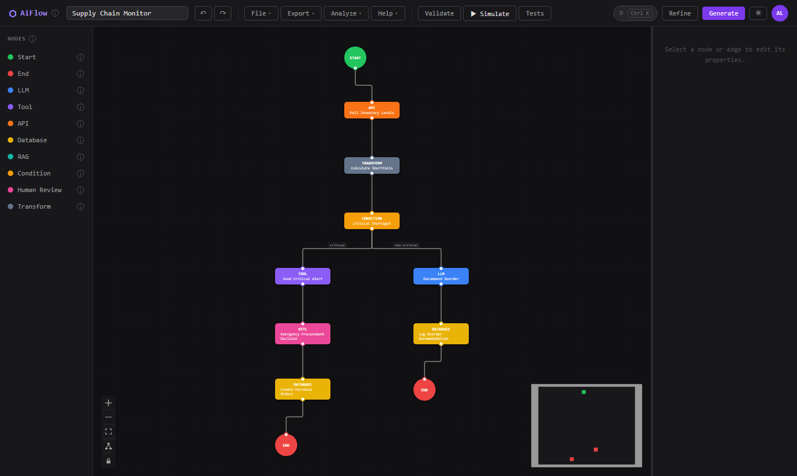

---

## The screen

**Top bar.** Everything you can do is reachable from here.

- **Workflow name**: click to rename. Beside it, a small note says **Unsaved changes** while you have edits that are not saved, or **Saved to cloud** when the cloud copy matches what is on screen.
- **↶ ↷**: undo and redo.
- **File**: new, open, save to a file, cloud workflows, examples.
- **Export**: edit the raw JSON, export code, Mermaid diagram, report.
- **Analyze**: explain the workflow, suggested changes, safety checks, run history.
- **Help**: search actions, About.
- **Validate**, **▶ Simulate**, **Tests**: the three things you will do most.
- **Search actions** (or **Ctrl+K**): type what you want to do and pick it from the list.
- **Refine** and **Generate**: work on the workflow with AI.
- Sun/moon button: light or dark appearance. Your initials open your account menu, which shows how much of today's allowance you have used.

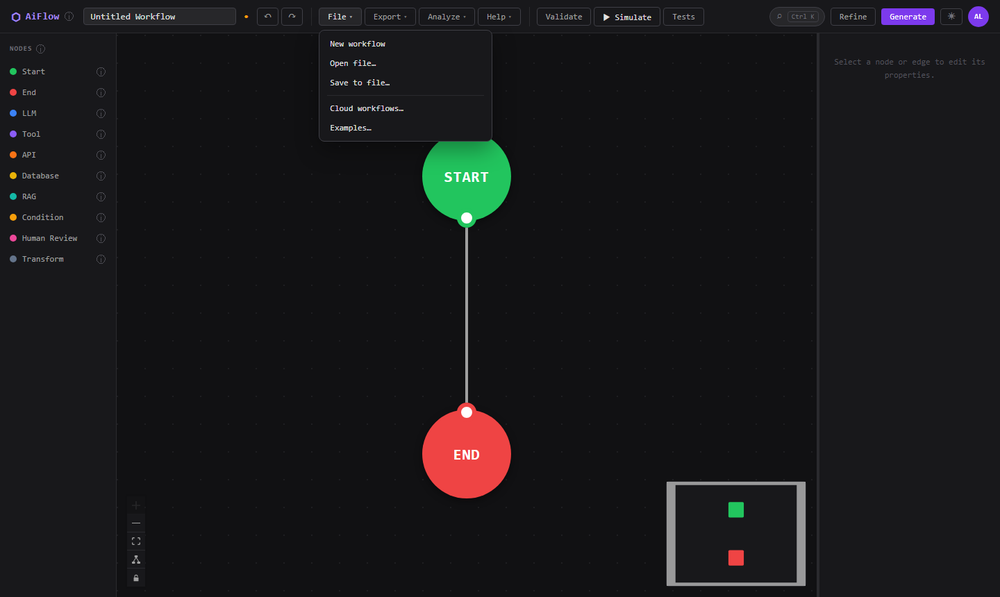

**Left: the step palette.** The ten kinds of step. Drag one onto the canvas to add it. The ⓘ next to each explains what it is for. Throughout the app, ⓘ dialogs that have a matching section here end with **Read more in the user guide**.

**Middle: the canvas.** Your workflow. Drag steps to move them, drag from the dot at the bottom of a step to the dot at the top of another to connect them. The small buttons at the bottom left zoom, fit the view, and tidy the layout automatically. The map in the bottom right shows where you are in a large workflow.

**Right: the panel.** Shows the settings of the step or connection you clicked. After a simulation it also has a *Simulation* tab with the step-by-step result.

**Bottom: the results strip.** After **Validate**, the verdict and any findings appear here.

---

## Starting a workflow

There are five ways to begin.

### Describe it and let AI draw it

Press **Generate**, describe what should happen in plain English, and send. The AI builds a workflow you can then edit.

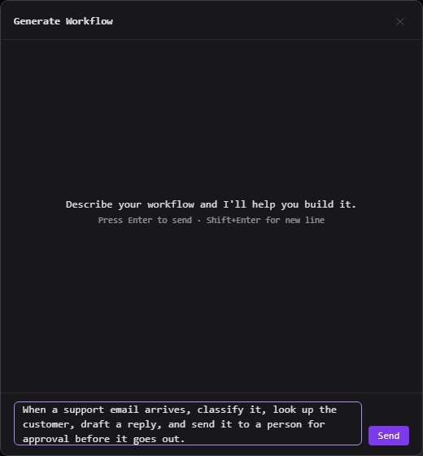

Good descriptions say *what triggers it*, *what each step decides or produces*, and *where a person should check something*. For example: "When a support email arrives, classify it, look up the customer, draft a reply, and send it to a person for approval before it goes out."

Once you have a workflow, **Refine** lets you ask for changes in a conversation ("add an approval before the refund is issued"). Each Generate or Refine request counts against your daily AI allowance (see [Limits](#limits-and-daily-allowances)).

### Start from an example

**File → Examples…** has ten ready-made workflows in three levels (easy, medium, complex) from several industries. Search by name, industry or tag. They are the best way to see what a good design looks like.

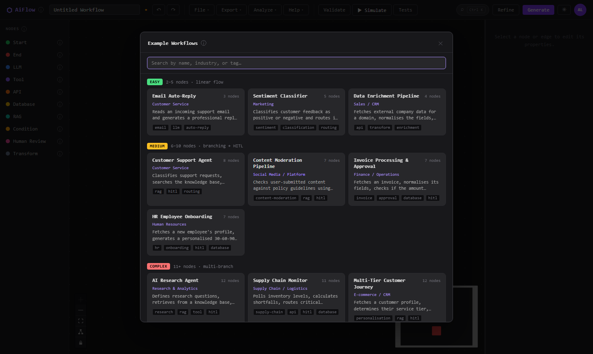

### Open a file

**File → Open file…** loads a workflow saved earlier as a JSON file.

### Import from elsewhere

- **Export → Mermaid diagram → Import**: paste a Mermaid flowchart.
- **Export → Code… → Import**: read a LangGraph (Python) project back into AiFlow.

### Start empty

**File → New workflow** gives you a Start and an End step to build between. Drag steps in from the palette on the left and connect them.

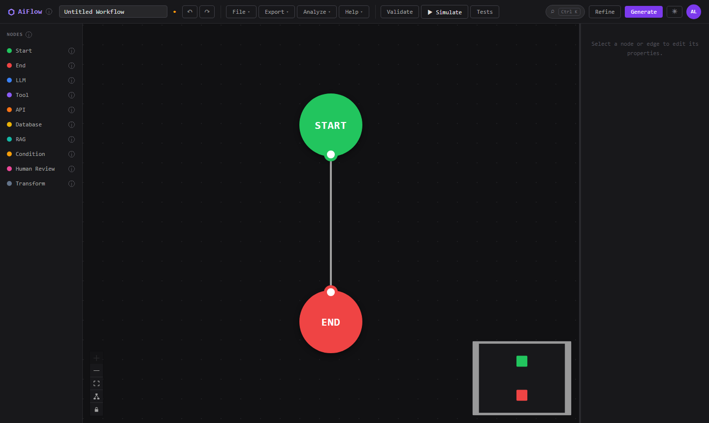

---

## Editing a workflow

Click a step to see and change its settings on the right. Changes apply immediately, and **Ctrl+Z** undoes them.

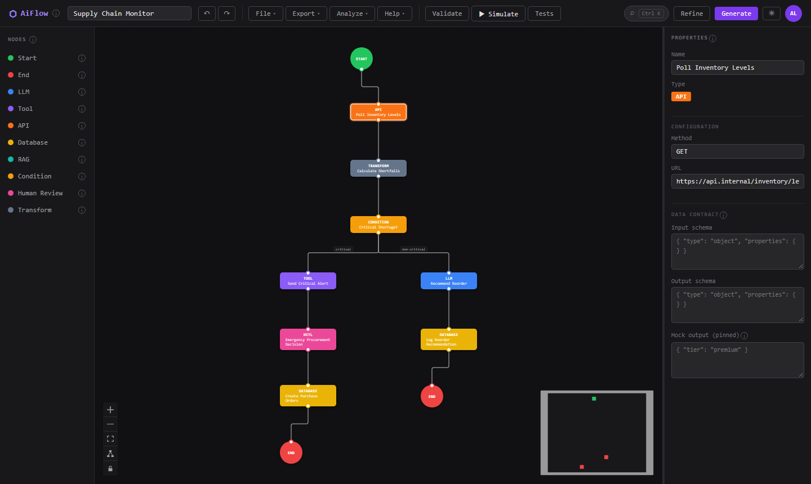

### The ten kinds of step

| Step | What it represents | What you set |
| --- | --- | --- |
| **Start** | Where the workflow begins and what comes in | Nothing |
| **End** | A way the workflow can finish (you can have several) | Nothing |
| **LLM** | A language model reading something and producing text or a decision | Model, prompt, temperature |
| **Tool** | An action the workflow can take, such as sending an email | Tool name, description |
| **API** | A call to another system over the web | Method (GET, POST…), URL |
| **Database** | Reading or changing records | Database type, connection reference, query |
| **RAG** | Looking things up in a knowledge base before answering | Knowledge base, how many results, similarity threshold |
| **Condition** | A decision that sends the flow down one of several branches | Expression |
| **Human Review** | A pause for a person to approve, reject or choose | Instructions for the reviewer |
| **Transform** | Reshaping data between steps | Description of the change |

### Connections and decisions

A connection is an arrow from one step to the next. After a **Condition** step, give every outgoing connection a **label**. The condition's expression produces a value, and the flow follows the connection whose label matches it.

- An expression like `"critical" if input.shortage_severity == "critical" else "non-critical"` produces the word `critical` or `non-critical`, so you need connections labelled exactly that.
- A true/false test uses the labels `true` and `false` (or `yes` and `no`).
- A connection labelled `else`, `default` or `otherwise` is used when nothing else matches.
- `input` is the data that reached the decision. Write `input.price` to read a field called `price`.

If AiFlow cannot work out which branch to take during a simulation, it follows all of them and tells you so, rather than guessing silently.

### Describing the data between steps

Steps pass data to each other. In the panel's **Data contract** section you can describe what a step expects (**Input schema**) and what it produces (**Output schema**) as a small JSON description. This does three things: simulations produce realistic made-up data, the checks can tell you when a decision reads a field nothing provides, and exported code can rely on it.

**Mock output (pinned)** lets you fix exactly what a step returns during simulations, for example `{ "tier": "premium" }`, so a test always takes the branch you want.

### Keeping secrets out

Never type a password, API key or token into a workflow. Where a step needs one, write a reference such as `env:SUPPLY_API_TOKEN` or `env:DB_URL`. The real value is supplied only where the exported code runs, so workflow files and shared links never contain secrets.

### Moving faster

- **Copy and paste** a selected step with **Ctrl+C** and **Ctrl+V**.
- Select several steps (for example by dragging a box with Shift held) and an alignment bar appears.
- The tidy-layout button on the canvas controls arranges the whole workflow neatly.
- **Export → Edit JSON** shows the underlying file if you want to edit it directly.

---

## Checking your design

Press **Validate**. AiFlow checks the structure first: there must be one Start and at least one End, every connection must join real steps, and so on. Problems in that list must be fixed before you rely on the workflow.

Then it adds **design findings**: advice on how the workflow will behave. Steps with a finding show a small badge on the canvas, and clicking a finding selects the step.

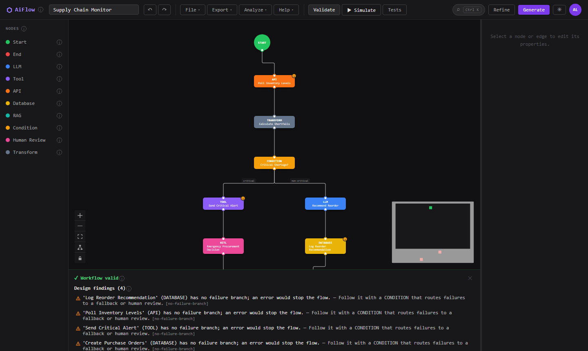

| Finding | What it means |
| --- | --- |
| Unreachable step | Nothing leads to it, so it never runs |
| Dead end | A step from which the flow can never reach an End |
| Decision with one branch | A Condition needs at least two outcomes |
| Unlabelled branch | A branch out of a decision has no label, so it cannot be matched |
| No failure branch | An API, database or tool step has nothing handling the case where it fails, so an error would stop the whole flow |
| Review after an irreversible step | A person is asked to approve something that has already happened |
| Missing data | A decision or step reads a field that nothing earlier provides |
| Cycle | The flow can loop back on itself |

The strip at the bottom also gives a rough **time and cost estimate** per path through the workflow. It is a guide, not a promise.

**Analyze → Explain** writes the workflow out in plain language for reviewers: what happens step by step, where people check things, which outside systems it touches, and anything the checks flagged. Copy it or download it as Markdown. It costs nothing, and always matches the workflow on screen.

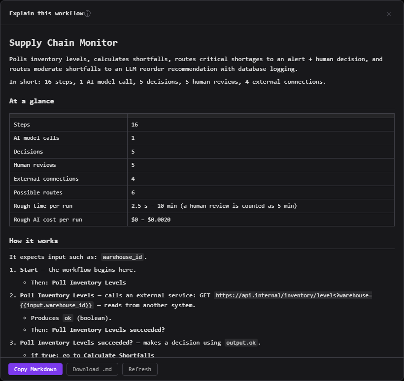

---

## Suggested changes

**Analyze → Suggest changes** proposes edits you can accept one at a time.

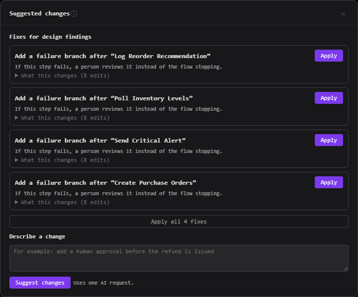

- **Fixes for design findings** are worked out from the workflow itself, so they are free and always the same. For example, a missing failure branch is fixed by adding a check after the step and a human review for when it fails. Open *What this changes* on a suggestion to see every edit it makes.
- **Describe a change** lets you type what you want ("add a human approval before the refund is issued") and the AI proposes edits. This uses one AI request.

Nothing changes until you press **Apply**. Each suggestion is applied completely or not at all, and checked first so it cannot leave the workflow broken. If a suggestion adds steps, AiFlow tidies the layout. **Ctrl+Z** undoes the whole thing in one go.

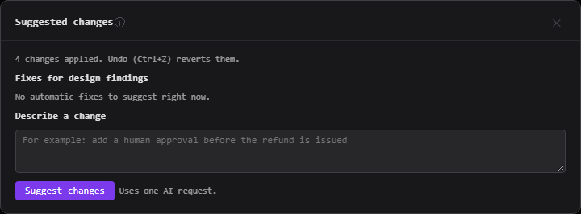

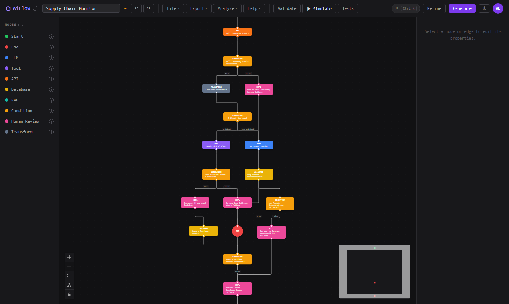

---

## Simulating a run

A simulation walks through the workflow with sample data so you can see which steps run and in what order. Press **▶ Simulate**.

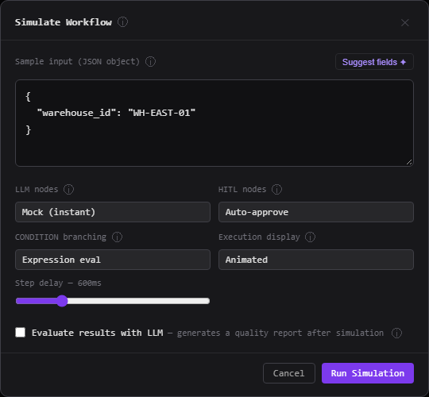

| Setting | Choices |
| --- | --- |
| **Sample input** | The data that enters at Start, as JSON. **Suggest fields ✦** proposes fields based on what the workflow reads. |
| **LLM nodes** | *Mock (instant)* produces made-up answers for free. *Real* calls the AI model and counts against your AI allowance. |
| **HITL nodes** | *Auto-approve* lets people's reviews pass. *Pause* stops at each review so you can approve or reject. |
| **CONDITION branching** | *Expression eval* follows the rules you wrote. *User pick* asks you which branch to take. *Random* picks one. |
| **Execution display** | *Animated* lights up steps one by one. *Instant* shows the end result. *Manual step-through* adds a **Next Step** button that reveals the run one step at a time. |
| **Evaluate results with LLM** | Optionally asks the AI to grade the run and write a short quality report. |

Press **Run Simulation**. Steps are coloured as they run, and the **Simulation** tab on the right lists what each step received and produced.

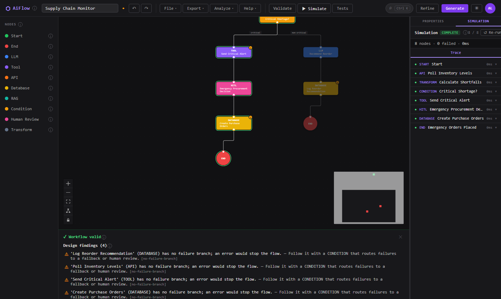

The made-up data is the same from one run to the next, so you can change the workflow and compare. Your recent runs are kept in **Analyze → Run history**, where you can open them again.

---

## Test suites

One simulation shows you one path. A **test suite** checks the workflow against many inputs at once and tells you which checks pass.

Press **Tests** to open the suites for the workflow on screen. A suite is a list of **cases**. Each case has:

- a name,
- the **input** to start with (and optionally a seed, to choose which made-up data is used),
- one or more **checks** that must be true afterwards.

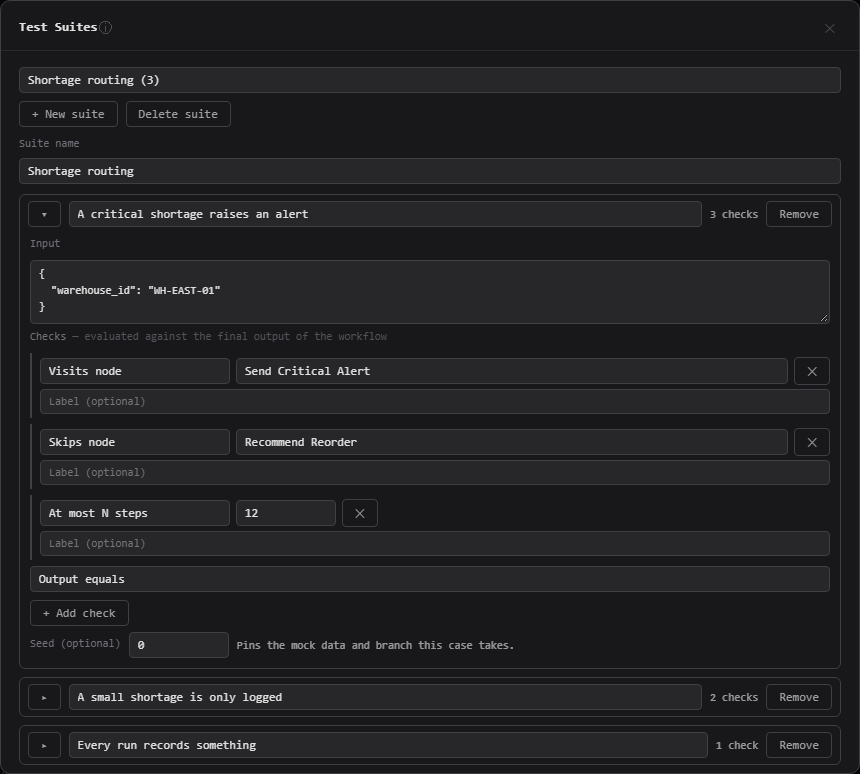

### Kinds of check

| Check | Passes when |
| --- | --- |
| Equals | A value in the result matches exactly |
| Contains | A value includes some text |
| Exists | A value is present |
| Compare | A number is greater or less than a limit |
| One of | A value is one of a list |
| Matches schema | The result has the shape you describe |
| Expression | A rule you write is true |
| Visits step | A particular step ran |
| Skips step | A particular step did not run |
| Max steps | The run took no more than a number of steps |

Press **▶ Run … cases**. You get the overall pass rate, each case with the reason any check failed, the path it took, and a **coverage** summary: which steps never ran in any case, and which branches were never taken. Gaps in coverage are where bugs hide.

Once a suite has at least two finished runs, **Pass rate over time** draws your last twelve as a small chart, with how the latest compares to the one before, so a slow decline is visible even when each run looks fine.

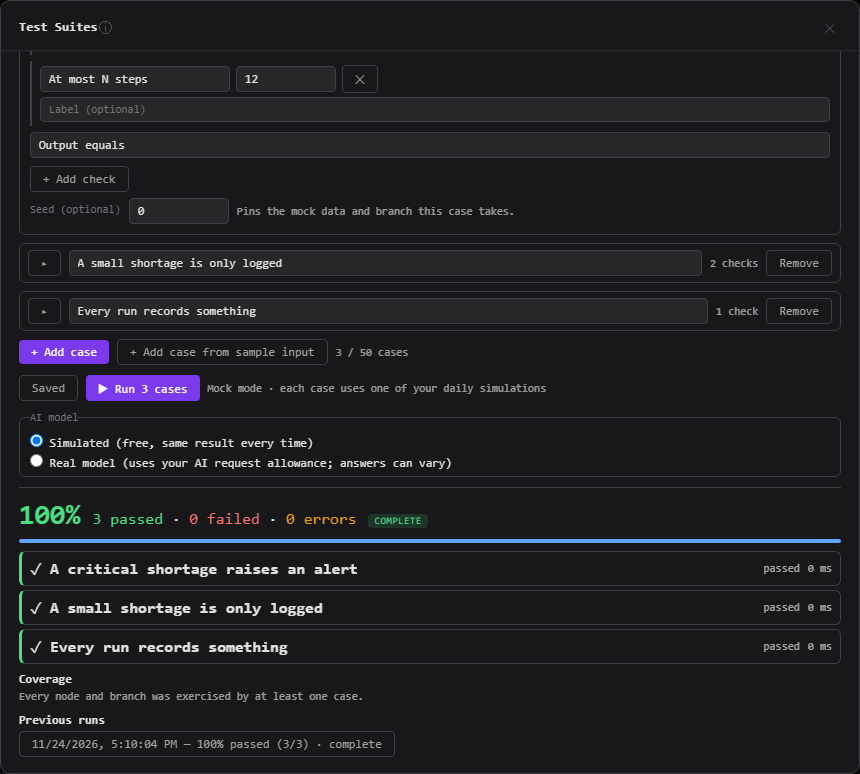

**Simulated** runs are free and give the same result every time. **Real model** runs call the AI for the steps that use one (answers can vary, and it uses your AI allowance). Before a real run starts you are shown what it will use.

### Comparing two runs

After you change a workflow, run the suite again and compare. Open a previous run, pick another run under **Compare with**, and press **Compare**.

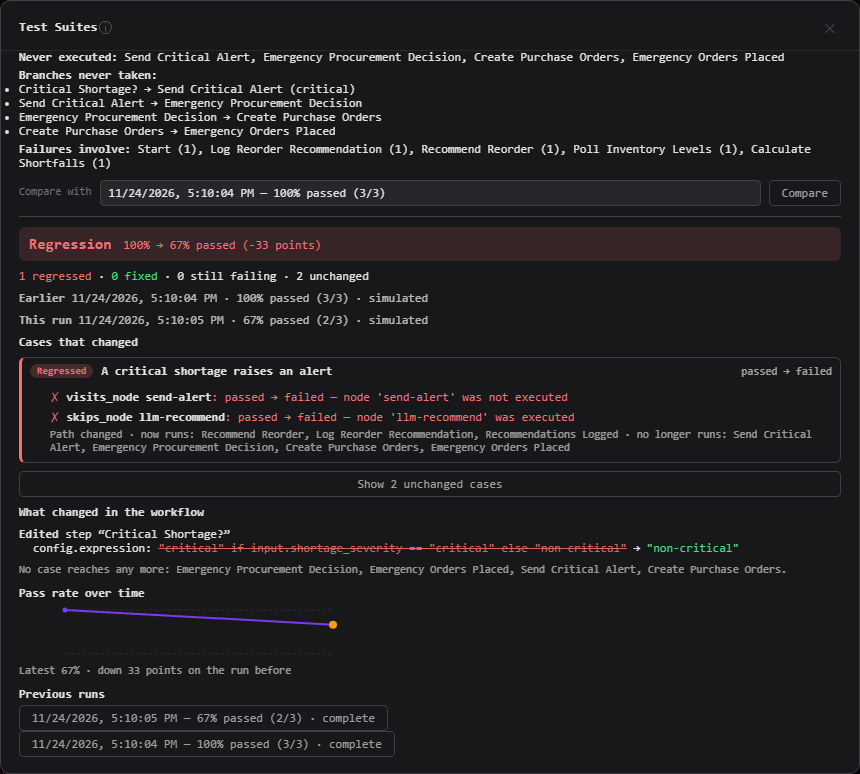

You get a verdict (regression, improvement or no change), and every case is sorted into *regressed*, *fixed*, *still failing*, *unchanged*, *new* or *removed*. For each case that changed you see which checks flipped and why, and which steps now run or no longer run. A **What changed in the workflow** section lists the edits made between the two runs, so a regression can be traced to its cause. Warnings tell you when a comparison is not fair, for example when one run used the real model and the other did not.

---

## Safety checks

**Analyze → Safety checks** looks for two kinds of weakness. Neither uses AI.

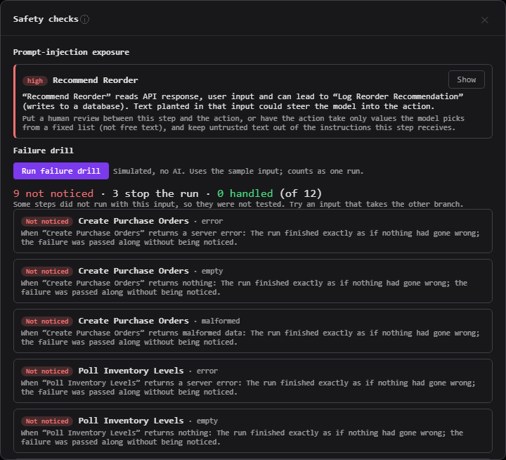

**Prompt-injection exposure.** AI models can be tricked by text hidden in the material they read: an email, a web page, a database record. This check finds every AI step that reads outside text *and* can lead to an action that changes something (writing to a database, calling a write API, using a tool). *High* means such an action is reachable with no person checking in between; *low* means a human review stands in the way. Each entry says how to reduce the risk, and **Show** takes you to the step.

**Failure drill.** Press **Run failure drill**. AiFlow makes each outside step fail in turn, in four ways (error, timeout, empty answer, malformed answer), and watches what the workflow does:

- **Handled**: the workflow noticed and took a different route, such as a human review.
- **Stops**: the run failed.
- **Not noticed**: the run finished exactly as if nothing was wrong. This is the dangerous result, because bad data flows on silently.

In the Supply Chain Monitor example, applying the suggested fixes (see [Suggested changes](#suggested-changes)) and running the drill again turns nine "not noticed" results into none: server errors are handled by the new human reviews, and the other failures stop the run visibly. The drill uses your sample input and counts as one simulation. Steps that did not run with that input are listed, so you can try another input to test the other branch.

These are design checks. They show where a workflow is exposed; they do not prove it is safe, and they do not test how a real model behaves.

---

## Saving, versions and sharing

### To a file

**File → Save to file…** downloads the workflow as a JSON file. **File → Open file…** loads one.

### To your account (cloud workflows)

**File → Cloud workflows…** keeps workflows in your account, with history.

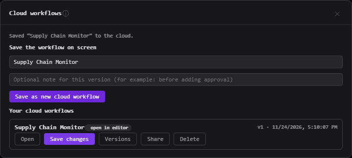

1. Type a name and an optional note, then **Save as new cloud workflow**.
2. Keep working. Open the dialog again and press **Save changes** (on the workflow marked *open in editor*) to add a new **version**. Saving without changes adds nothing.
3. **Versions** lists every version. **Changes since** shows what was added, removed or edited between that version and now. **Restore** brings an old version back as a *new* version, so nothing is ever lost.

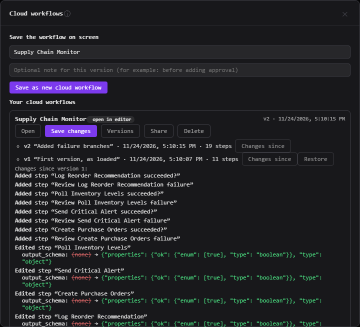

You can keep up to 30 workflows, and the newest 30 versions of each.

### Sharing a read-only link

Press **Share** on a cloud workflow to get a link.

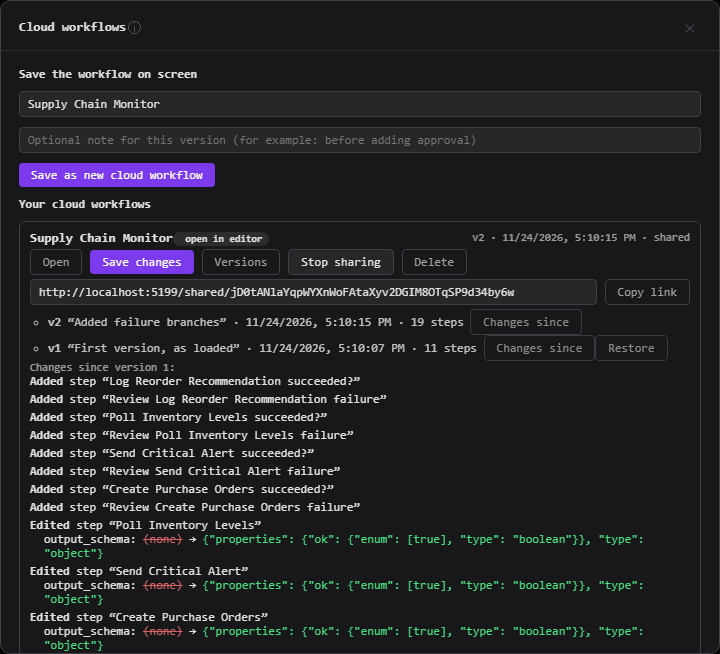

Anyone with the link can open it **without signing in** and see the workflow on a canvas, with a button to download it. They cannot change anything, and they cannot see who owns it. The link always shows the current version. A visitor who is signed in to AiFlow also gets **Save a copy to my cloud workflows**, which adds a copy named "… (copy)" to their own account (they open it from File, then Cloud workflows).

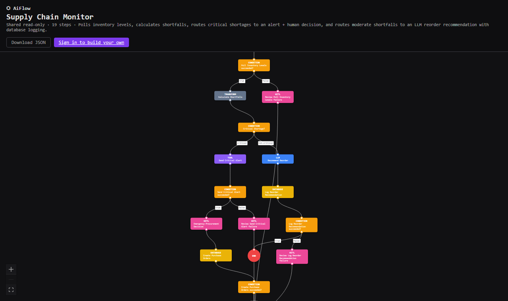

Press **Stop sharing** to switch the link off permanently. Sharing again creates a new address. Deleting the workflow also ends its link. Remember that anyone who has the link can see the workflow, so do not share designs containing anything private.

---

## Exporting and importing

### Code

**Export → Code…** turns the workflow into a project you can run.

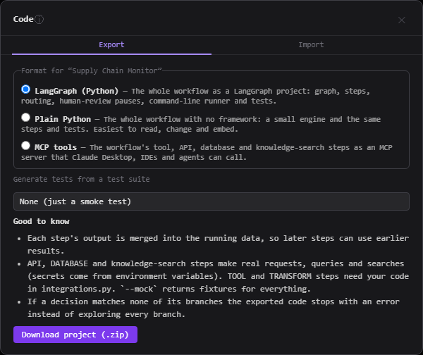

| Target | What you get |
| --- | --- |
| **LangGraph** | A Python project using the LangGraph library |
| **Plain Python** | A Python project with no framework |
| **MCP server** | A project that offers the workflow as tools to other AI applications |

The project includes the workflow, the settings for each step, your test cases, and working connections for API and database steps. Secrets are read from environment variables (the `env:` references you used), never written into the files. The same dialog can **import** a LangGraph project back into AiFlow.

### Mermaid diagram

**Export → Mermaid diagram** gives text you can paste into documents and wikis that draw Mermaid flowcharts. You can also import one.

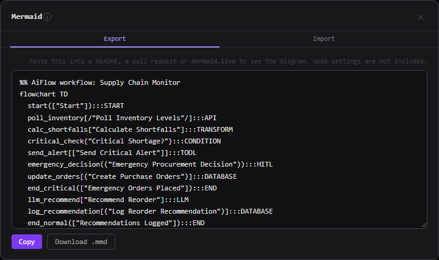

### Report and JSON

**Export → Report** produces a report of the workflow and its latest run. **Export → Edit JSON** shows the underlying file.

---

## Limits and daily allowances

Some actions use a daily allowance. Your account menu (your initials, top right) shows what you have used today.

| Action | Counts as |
| --- | --- |
| Generate, Refine, *Describe a change*, a real-model run, an AI evaluation | One AI request |
| ▶ Simulate, each test case, the failure drill | One simulation |
| Validate, Explain, fixes for findings, injection exposure, export, comparing runs, everything in the cloud dialog | Free |

Demo accounts get **10 simulations and 20 AI requests a day**. Approved accounts have no daily cap unless the owner sets one. When you reach a limit you will see a message saying so, and it resets the next day.

Other limits:

- **Test suites:** up to 20 suites, and 10 cases per suite on a demo account (50 otherwise). A real-model run is limited to 20 cases.
- **Cloud:** 30 workflows, the newest 30 versions of each.
- **Run history:** your latest 50 runs, kept for 30 days.
- **Time:** a single request that takes longer than about 28 seconds is stopped. If a simulation times out, use mock mode or a smaller workflow.
- **Size:** very large workflows (more than 100 steps) are not accepted.

---

## Keyboard shortcuts and search

Press **Ctrl+K** (**⌘K** on a Mac) anywhere to open the action search, type a few letters of what you want ("share", "export", "safety"), and press **Enter**. It finds actions by name and by what they do, and it remembers your last few: until you type, those come first, marked *Recent*.

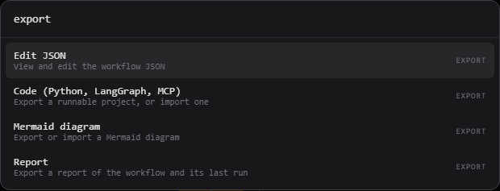

| Keys | Does |
| --- | --- |
| Ctrl+K (⌘K) | Search all actions |
| Ctrl+Z | Undo |
| Ctrl+Y or Ctrl+Shift+Z | Redo |
| Ctrl+C, Ctrl+V | Copy and paste the selected step |
| Delete | Remove the selected step or connection |
| Esc | Close the open dialog or menu |

Inside menus, use the arrow keys to move, **Enter** to choose and **Esc** to close.

---

## Troubleshooting

**"Daily … limit reached."** You have used today's allowance. It resets the next day. Free actions such as Validate and Explain still work.

**"The AI request timed out."** Try a shorter description, or try again.

**A suggestion says it "could not be applied".** The workflow changed since the suggestion was made. Close the dialog and open Suggest changes again.

**A simulation follows every branch and warns.** A decision could not be evaluated: its expression reads a field the earlier step did not produce, or its result matches no branch label. Check the labels, or describe the earlier step's output under *Data contract*.

**A shared link says it is "not valid or no longer shared".** The owner turned sharing off or deleted the workflow.

**A banner says a newer version is available.** AiFlow was updated while your page was open. Press **Reload**.

**Something looks wrong and you need to report it.** Open **Help → About AiFlow**, press **Copy version info**, and include that line in your report. The same dialog shows the version of the page and of the server, and what changed in each release.

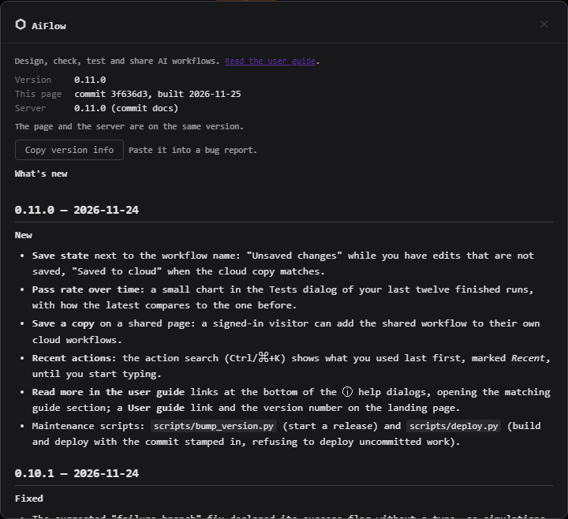

---

## Words used in AiFlow

| Word | Meaning |
| --- | --- |
| **Workflow** | The whole map of steps and connections |
| **Step** (node) | One box on the map |
| **Connection** (edge) | An arrow between two steps; after a decision it carries a label |
| **Branch** | One of the paths out of a decision |
| **Simulation** | A rehearsal with made-up data; nothing real is called |
| **Mock** | Made-up output used in place of a real model or system |
| **Seed** | A number that makes the made-up data repeat, so runs can be compared |
| **Test case / suite** | One input with its checks / a list of cases |
| **Coverage** | How much of the workflow your tests actually exercise |
| **Regression** | Something that used to pass and now fails |
| **Version** | A saved copy of a cloud workflow at a moment in time |
| **Prompt injection** | Text planted in material an AI reads, trying to make it do something else |
| **Human review** (HITL) | A step where a person approves, rejects or chooses |
