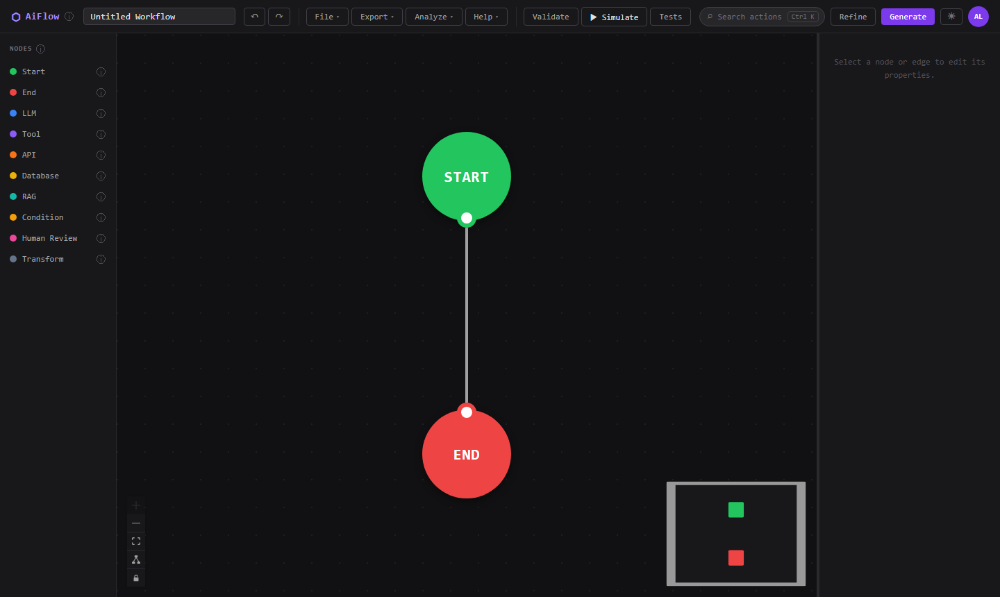
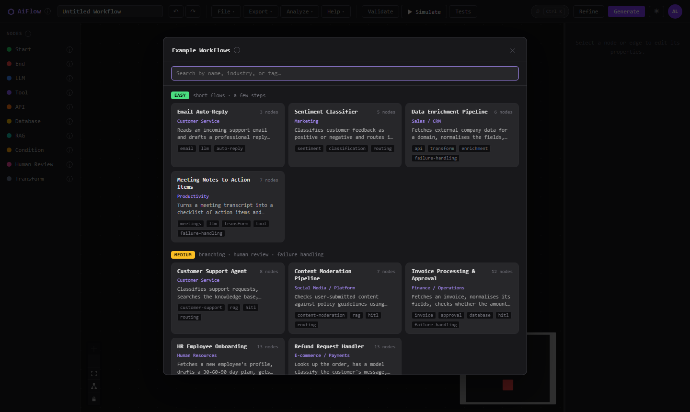
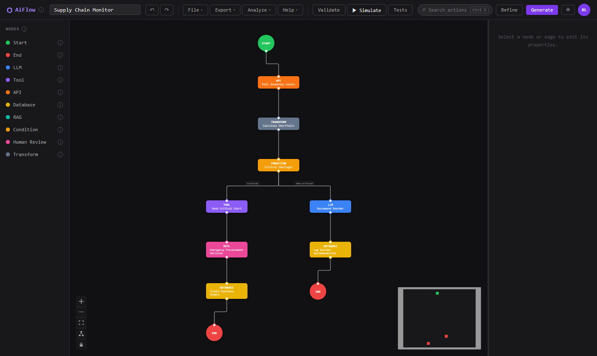
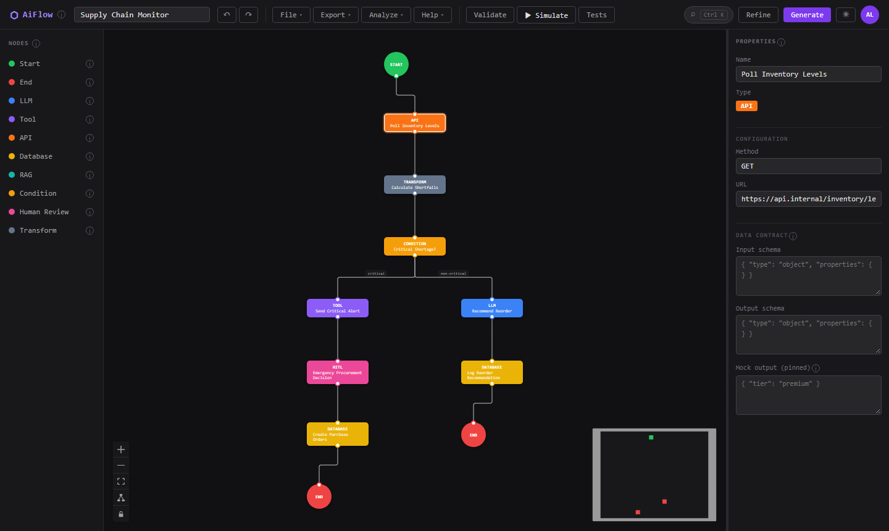
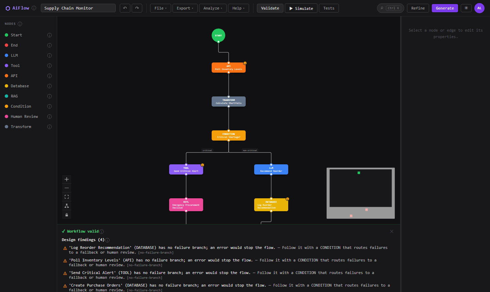
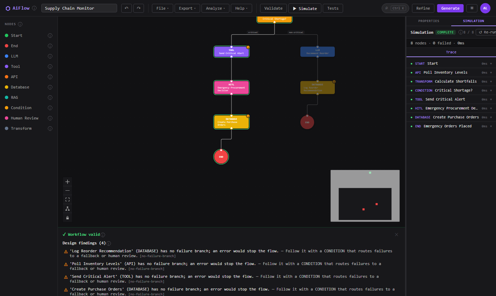
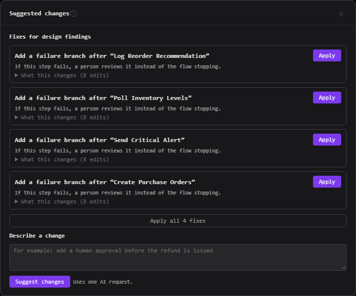
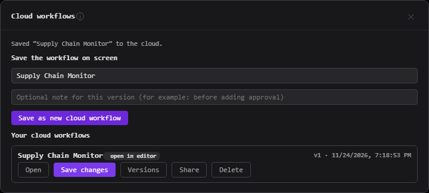

# Video 1 — Quick start

**Length:** about 3 minutes · **Example used:** Supply Chain Monitor
**Goal:** the viewer opens a ready-made workflow, checks it, runs it, fixes what the check found, and saves it.
**Guide section:** [Quick start](../user-guide/README.md#quick-start-five-minutes)

---

### Scene 1 — What AiFlow is (0:00 – 0:20)

**On screen:** hold on the empty editor. Briefly highlight the top bar, then the left palette.

**Narration:** AiFlow is a tool for designing AI workflows: maps of steps where a model writes something, a person approves it, and a system gets updated. In the next three minutes you will open a ready-made workflow, check it, run it, and keep it.

---

### Scene 2 — Open an example (0:20 – 0:45)

**On screen:** highlight the **File** menu path in a caption, then the *Supply Chain Monitor* card in the "Complex" row.

**Narration:** Start with File, then Examples. There are ten ready-made workflows, from easy to complex. Pick Supply Chain Monitor. It watches stock levels, and then either raises an alert and asks a person to decide, or simply logs a recommendation.

---

### Scene 3 — Find your way around (0:45 – 1:10)

**On screen:** highlight in turn: the palette on the left, the canvas, the empty panel on the right, then the **Search actions** box in the top bar.

**Narration:** Here is the workflow. Each box is a step, and each arrow is a connection. The palette on the left holds the kinds of step you can add. The panel on the right shows settings. Everything else is in the menus along the top, or press Control K and type what you want to do.

---

### Scene 4 — Look at a step (1:10 – 1:30)

**On screen:** zoom into the right panel: Name, Type, Method, URL.

**Narration:** Click a step to see its settings. This one calls another system: you can see the method and the address. One rule to remember: you never type passwords or keys into a workflow. You refer to them by name, and the real value stays wherever the workflow actually runs.

---

### Scene 5 — Check it (1:30 – 1:55)

**On screen:** highlight **Validate**, the green "Workflow valid" line, then the first design finding. Show the small badges on the steps.

**Narration:** Press Validate. The structure is fine, but the design check has found four things. Four steps call outside systems and nothing handles the case where they fail. If one of them did fail, the whole flow would simply stop.

---

### Scene 6 — Run it (1:55 – 2:20)

**On screen:** briefly show the settings dialog first (screenshot `08-simulate-setup.png`), then this result. Highlight the lit-up path and the step list on the right.

**Narration:** Now press Simulate, then Run Simulation. The default uses made-up answers, so nothing real is called and it costs nothing. Steps light up as they run, and the right panel lists what each step received and produced.

---

### Scene 7 — Fix what was found (2:20 – 2:50)

**On screen:** highlight "Fixes for design findings", then press **Apply all 4 fixes**; cut to the tidied result (`16-editor-after-fixes.png`).

**Narration:** Open Analyze, then Suggest changes. AiFlow proposes a fix for each finding: a check after the step, and a human review for when it fails. Press Apply all. The layout is tidied, and a single undo reverses the whole change.

---

### Scene 8 — Keep it (2:50 – 3:10)

**On screen:** highlight **File, Save to file** in a caption, then the Cloud workflows dialog.

**Narration:** To keep your work, use File, Save to file, or File, Cloud workflows to store it in your account with a history of versions. That is the whole loop: open or describe, check, run, fix, save. The next videos cover testing, safety checks, and sharing.

---

**Chapter markers:** 0:00 What AiFlow is · 0:20 Open an example · 0:45 Find your way around · 1:10 Look at a step · 1:30 Check it · 1:55 Run it · 2:20 Fix what was found · 2:50 Keep it

**One-line summary:** Open a workflow, press Validate, press Simulate, apply the suggested fixes, and save.
