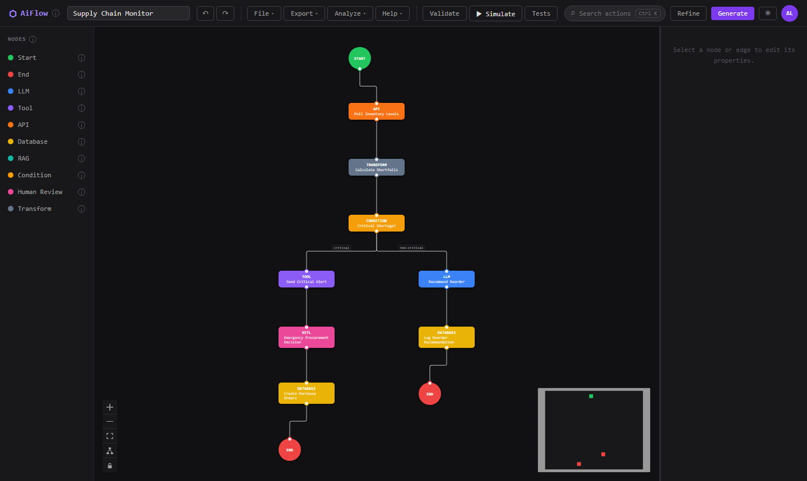
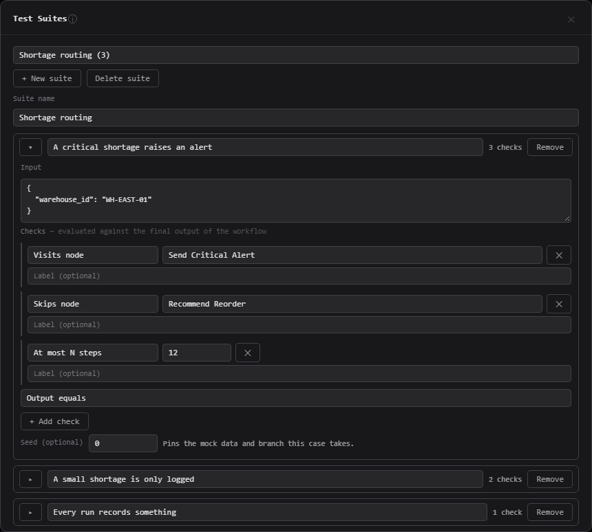
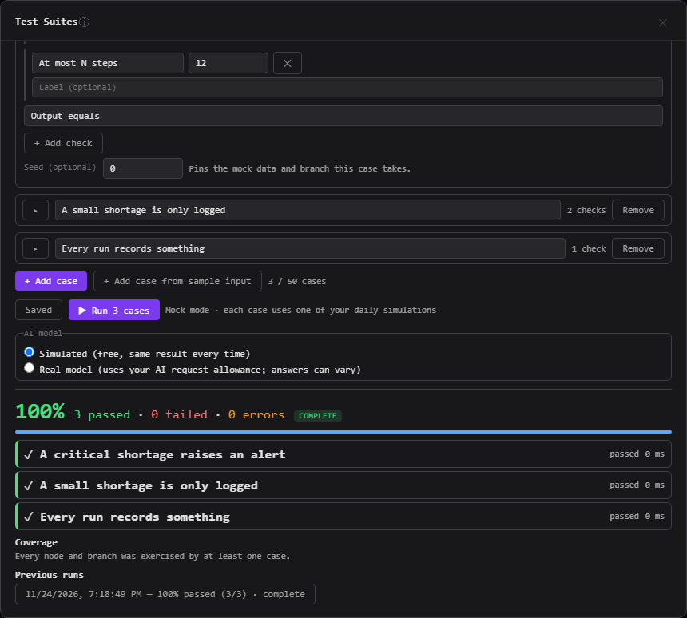
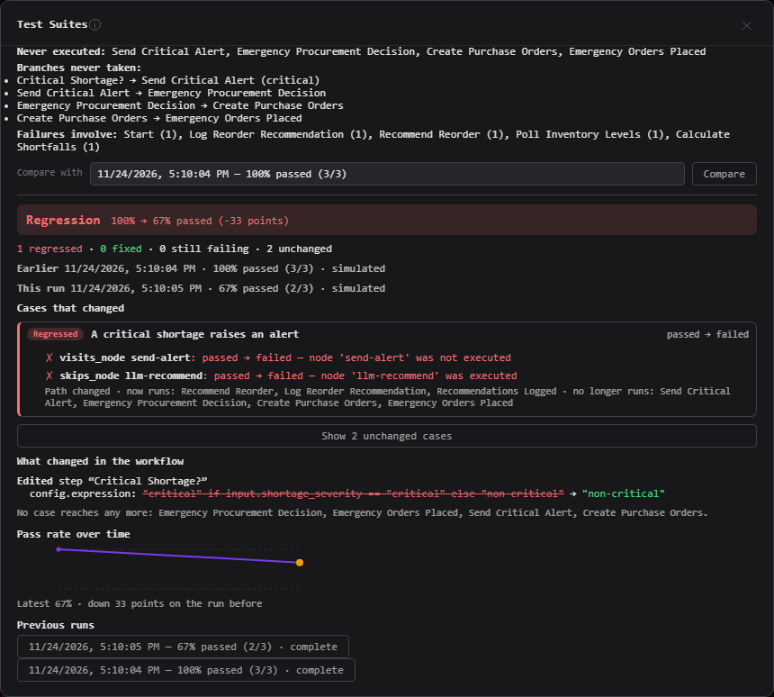

# Video 2 — Test suites and comparing runs

**Length:** about 4 minutes · **Example used:** Supply Chain Monitor
**Goal:** the viewer sets up checks that run against many inputs, reads the report, and finds out what a change broke.
**Guide section:** [Test suites](../user-guide/README.md#test-suites)

---

### Scene 1 — Why test (0:00 – 0:25)

**On screen:** the workflow, with the decision step ("Critical Shortage?") highlighted and its two branches.

**Narration:** One simulation shows you one path through a workflow. But this workflow has a decision in it, and each side leads somewhere different. A test suite checks many inputs at once, and tells you whether every path still does what you expect, even after you change something.

---

### Scene 2 — A suite is a list of cases (0:25 – 1:05)

**On screen:** the **Tests** button, then the three case names, then expand one case to show its input, its checks and its seed.

**Narration:** Press Tests. A suite is a list of cases. Each case has a name, an input to start with, and one or more checks that must be true afterwards. This suite has three cases: a critical shortage should raise an alert, a small shortage should only be logged, and every run should record something. The seed is optional. It pins which made-up data the case uses, so it takes the same branch every time.

---

### Scene 3 — The kinds of check (1:05 – 1:40)

**On screen:** zoom on the three check rows ("Visits node", "Skips node", "At most N steps") and the **+ Add check** button. Caption the ten check types as a list as they are named.

**Narration:** There are ten kinds of check. You can test that a value equals something, contains some text, exists, compares to a limit, is one of a list, or matches a shape. You can write your own rule as an expression. And you can check the path itself: that a step ran, that a step did not run, or that the whole run took no more than a number of steps. Here we use the path checks.

---

### Scene 4 — Run and read the report (1:40 – 2:25)

**On screen:** the **Run 3 cases** button, then the big "100%" and the three green cases, then the Coverage line.

**Narration:** Press Run three cases. The report shows the pass rate, and each case with its result. All three passed. Below that is coverage, which is easy to overlook and very useful: it says which steps and branches no case ever reached. Here it says every step and branch was exercised by at least one case. If it listed steps that never ran, that is where untested behaviour is hiding.

---

### Scene 5 — Change something, then compare (2:25 – 3:20)

**On screen:** the **Compare with** drop-down and **Compare** button, then the red verdict banner, the regressed case, and the "What changed in the workflow" section with the before and after of the expression.

**Narration:** Now suppose someone tidies up the decision, and by mistake it always answers non-critical. Run the suite again, open the new run, choose the earlier run under Compare with, and press Compare. The verdict is Regression: from one hundred percent down to sixty-seven. The case that broke is listed first, with the checks that flipped and the steps that now run and no longer run. And at the bottom, the edit that caused it, shown before and after.

---

### Scene 6 — Simulated or real model (3:20 – 3:45)

**On screen:** highlight the **AI model** choice: "Simulated" and "Real model".

**Narration:** Runs can be simulated, which is free and gives the same result every time, or use the real model. Real runs can vary, they use your daily AI allowance, and you are shown what a run will use before it starts. When two runs differ in mode, the comparison warns you that they are not directly comparable.

---

### Scene 7 — Limits, and what to do next (3:45 – 4:05)

**On screen:** hold on the top bar with **Tests** highlighted; caption the limits.

**Narration:** A demo account can have ten cases per suite, other accounts fifty, and up to twenty suites in all. A good habit: add a case whenever you find a problem, and run the suite after every change. Then a regression shows up the same day, with its cause attached.

---

**Chapter markers:** 0:00 Why test · 0:25 A suite is a list of cases · 1:05 The kinds of check · 1:40 Run and read the report · 2:25 Change something, then compare · 3:20 Simulated or real model · 3:45 Limits and next steps

**One-line summary:** A test suite runs your checks on many inputs, shows what was never tested, and a comparison shows exactly which change broke which case.
