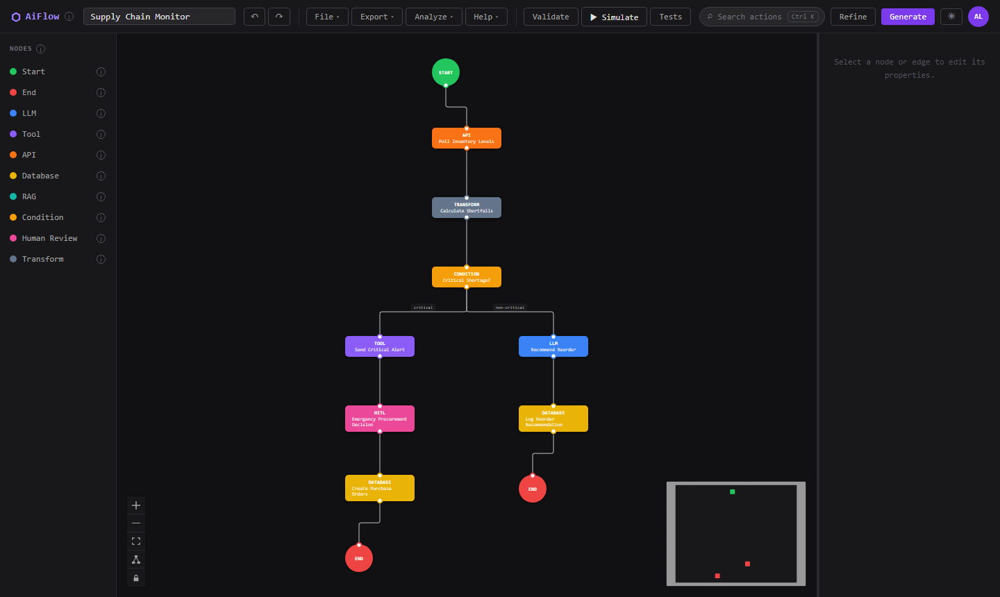
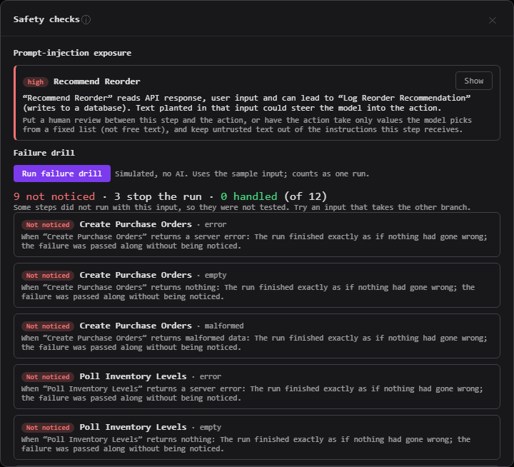
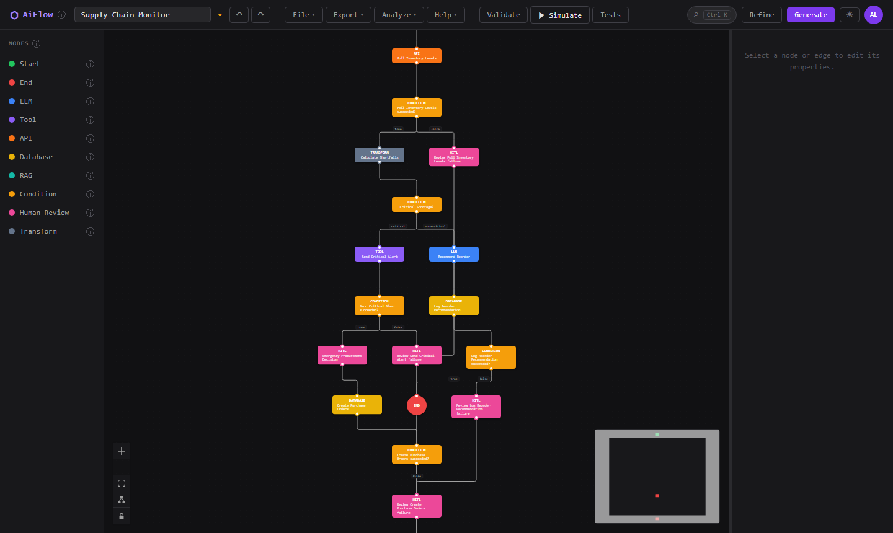

# Video 3 — Safety checks

**Length:** about 3 minutes · **Example used:** Supply Chain Monitor
**Goal:** the viewer finds where a workflow could be steered by planted text, finds which failures go unnoticed, and fixes them.
**Guide section:** [Safety checks](../user-guide/README.md#safety-checks)

---

### Scene 1 — Two ways a workflow goes wrong (0:00 – 0:25)

**On screen:** the workflow; trace a finger along the path from the API step through to the database steps.

**Narration:** A workflow can go wrong in two quiet ways. First, an AI step can read text that someone planted, in an email, a web page or a database record, and be talked into doing something it should not. Second, a system the workflow depends on can fail, and nothing notices. The Safety checks look for both, and neither uses the AI.

---

### Scene 2 — Open the checks (0:25 – 0:45)

**On screen:** the menu path **Analyze, Safety checks** as a caption, then the dialog with its two sections.

**Narration:** Open Analyze, then Safety checks. There are two sections: prompt-injection exposure at the top, and the failure drill below it.

---

### Scene 3 — Injection exposure (0:45 – 1:30)

**On screen:** zoom on the red "high" card: the step name, the sentence beginning "reads API response, user input", and the advice line. Point at the **Show** button.

**Narration:** Exposure looks at the design. It finds every AI step that reads outside text, and that can lead to an action that changes something: writing to a database, calling a system that makes changes, or using a tool. Here, "Recommend Reorder" reads an API response and user input, and its answer leads to a database write. That is marked high, because nothing checks the answer before it is written. Each entry says what to do: put a human review in between, or let the action take only values chosen from a fixed list. Show takes you to the step.

---

### Scene 4 — The failure drill (1:30 – 2:15)

**On screen:** the **Run failure drill** button, then the summary line ("9 not noticed, 3 stop the run, 0 handled") and two or three of the result cards.

**Narration:** Now press Run failure drill. AiFlow makes each outside step fail in turn, in four ways: an error, a timeout, an empty answer, and a malformed answer. Then it watches what the workflow does. There are three outcomes. Handled means the workflow noticed and took another route. Stops means the run failed. And not noticed, the dangerous one, means the run finished exactly as if nothing was wrong, so bad data flowed on silently. In this workflow, nine cases were not noticed and none were handled.

---

### Scene 5 — Fix and check again (2:15 – 2:45)

**On screen:** show Analyze, Suggest changes (`14-suggest.png`), then the result here: the new check and review steps after each outside step. If you re-record the drill, the expected result for this example is: 3 handled, 9 stop the run, 0 not noticed (it was 9 not noticed, 3 stop, 0 handled before).

**Narration:** The fix is the same one from the quick start. Open Suggest changes and apply the fixes. After each outside step there is now a check, and a human review for the case where it fails. Run the failure drill again. Nothing is left unnoticed. A server error is now handled: it goes to the human review. An empty answer, a malformed answer or a timeout stops the run, which is a loud failure instead of a silent one.

---

### Scene 6 — What this does and does not tell you (2:45 – 3:10)

**On screen:** hold on the dialog; caption "Design checks, not proof of safety."

**Narration:** Keep in mind what these are. They are design checks. They show where a workflow is exposed. They do not prove it is safe, and they do not test how a real model behaves. The drill runs on simulated data, uses your sample input, and counts as one simulation. If some steps did not run with that input, they are listed, so try another input to test the other branch.

---

**Chapter markers:** 0:00 Two ways a workflow goes wrong · 0:25 Open the checks · 0:45 Injection exposure · 1:30 The failure drill · 2:15 Fix and check again · 2:45 What this tells you

**One-line summary:** Exposure shows where planted text could reach an action; the drill shows which failures nobody would notice; the suggested fixes close both gaps you can see.
