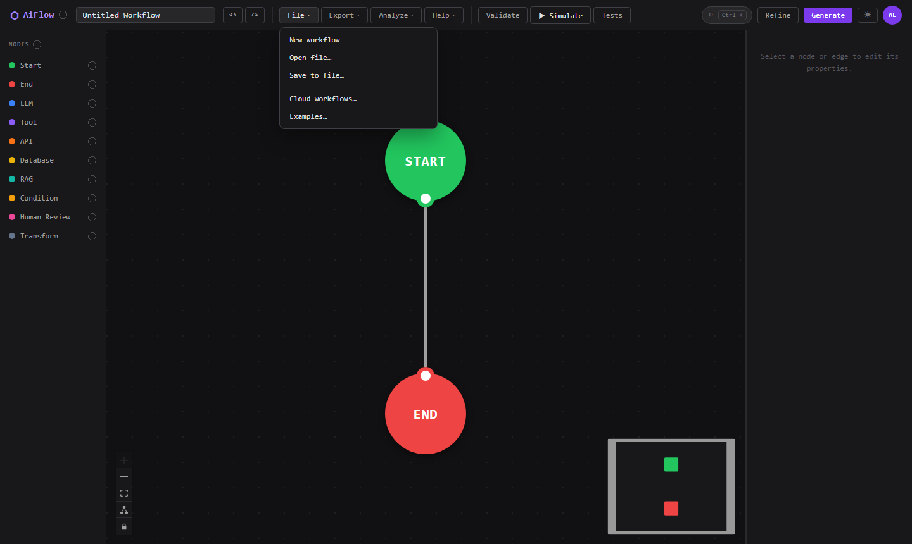
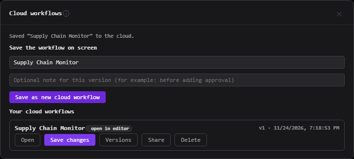
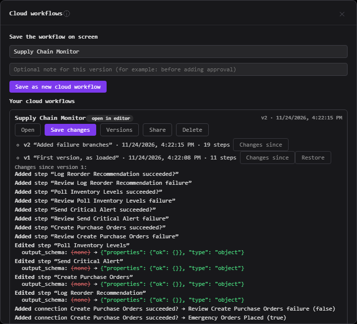
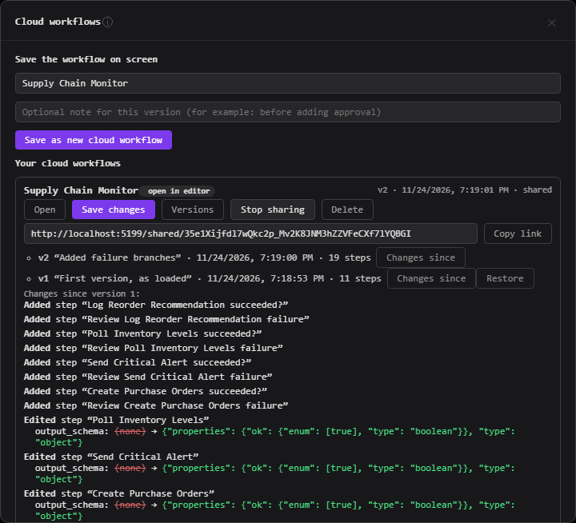
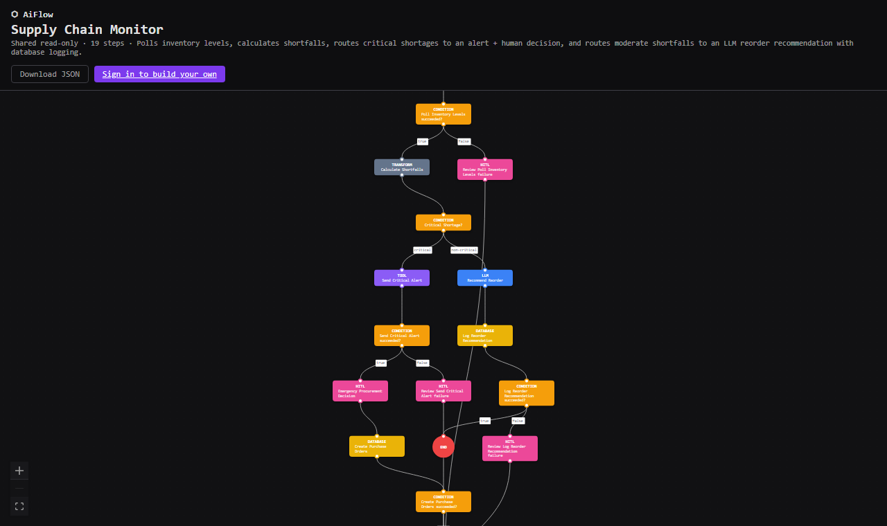
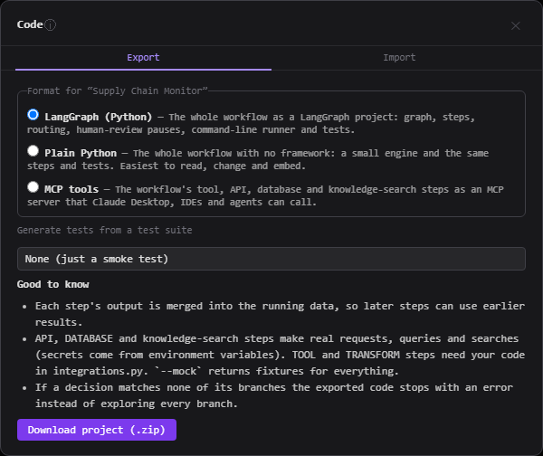
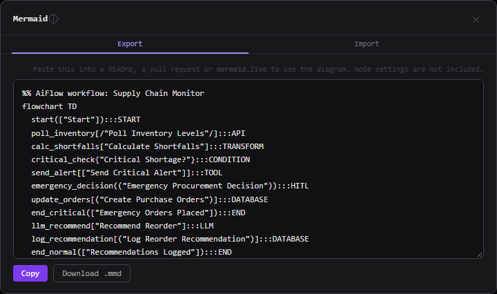

# Video 4 — Saving, sharing and exporting

**Length:** about 3½ minutes · **Example used:** Supply Chain Monitor
**Goal:** the viewer keeps versions of a workflow in their account, shares a read-only link, and exports working code.
**Guide sections:** [Saving, versions and sharing](../user-guide/README.md#saving-versions-and-sharing) · [Exporting and importing](../user-guide/README.md#exporting-and-importing)

---

### Scene 1 — Beyond a file (0:00 – 0:20)

**On screen:** the open **File** menu; highlight "Save to file…" and then "Cloud workflows…".

**Narration:** You can always save a workflow as a file. But if you want to come back to earlier versions, or show it to someone, keep it in the cloud. Open File, then Cloud workflows.

---

### Scene 2 — Save to your account (0:20 – 0:50)

**On screen:** the **Name** and **Version note** boxes, then **Save as new cloud workflow**, then the new entry marked "open in editor".

**Narration:** Give it a name, add a short note if you like, and press Save as new cloud workflow. It appears in your list, marked as the one open in the editor. You can keep up to thirty workflows in the cloud.

---

### Scene 3 — Versions: see what changed, go back (0:50 – 1:40)

**On screen:** the two versions with their notes, then press **Changes since** and scroll the list of "Added step" lines and the "Edited step" lines with before and after.

**Narration:** Keep working. When you want to keep a new state, open the dialog again and press Save changes. That adds version two. Saving when nothing has changed adds nothing. Press Versions to see the history. Changes since shows exactly what was added, removed or edited between a version and now. Here, version two added a check and a human review after each outside step. Restore brings an old version back as a new version, so nothing is ever lost. The newest thirty versions are kept.

---

### Scene 4 — Share a read-only link (1:40 – 2:15)

**On screen:** press **Share**, show the link field and **Copy link**; caption "Anyone with this link can look, nobody can change."

**Narration:** To show someone the workflow, press Share. You get a link. Copy it and send it. Anyone who has it can open the workflow without signing in, but they can only look: they cannot change anything, and they cannot see who owns it. Remember that anyone with the link can see the workflow, so do not share designs that contain anything private.

---

### Scene 5 — What the visitor sees (2:15 – 2:40)

**On screen:** the whole page; point at the **Download JSON** button and the **Sign in to build your own** button.

**Narration:** This is what your visitor sees: the workflow on a canvas, with a button to download it. The link always shows the current version. When you are done, press Stop sharing. The link stops working for good, and sharing again creates a new address.

---

### Scene 6 — Export working code (2:40 – 3:20)

**On screen:** the three format choices, then "Generate tests from a test suite", then **Download project**.

**Narration:** When the design is ready, turn it into something that runs. Open Export, then Code. Choose a format: LangGraph, plain Python, or tools for MCP, which lets other AI applications call your workflow. You can include tests generated from a test suite. Download the project as a zip. Steps that call other systems make real requests, and passwords and keys are read from environment variables, never written into the files. The same dialog can import a LangGraph project back into AiFlow.

---

### Scene 7 — Diagram for documents (3:20 – 3:35)

**On screen:** the text box with the diagram text; the **Copy** button.

**Narration:** And if you just want a picture for a wiki or a document, Export, Mermaid diagram gives you text that those tools draw as a flowchart.

---

**Chapter markers:** 0:00 Beyond a file · 0:20 Save to your account · 0:50 Versions · 1:40 Share a read-only link · 2:15 What the visitor sees · 2:40 Export working code · 3:20 Diagram for documents

**One-line summary:** Save versions in the cloud, share a link that only lets people look, and export the design as code you can run.
